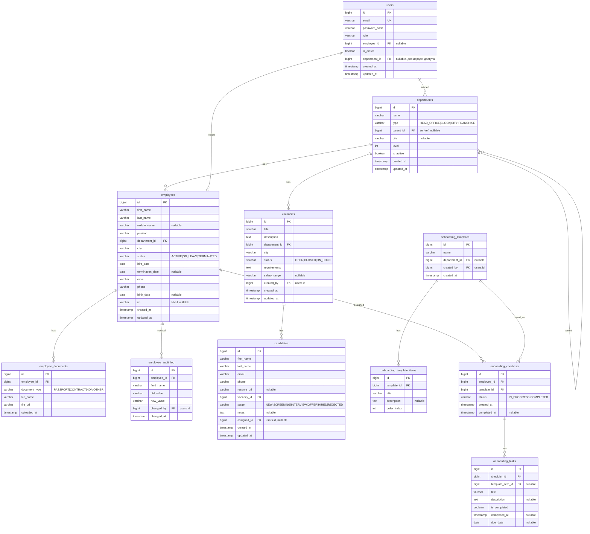

# Digital HR — Дизайн-документ MVP

## 1. ER-схема базы данных



### Ключевые решения по модели данных

| Решение | Обоснование |
|---------|-------------|
| `departments` — self-referencing дерево | Универсальное: офис → блок → город → франшиза через `parent_id` и `type` |
| `users.department_id` | Определяет scope видимости: пользователь видит свой department и всех потомков |
| `employee_audit_log` | Простой audit trail — запись каждого изменённого поля |
| `candidates.stage` как enum-строка | Проще для MVP, чем отдельная state-machine таблица |
| `onboarding_templates` отдельно от чеклистов | Шаблон переиспользуется, а чеклист — конкретный инстанс для сотрудника |

---

## 2. REST API — Эндпоинты

> Префикс: `/api/v1`
> Формат ответа: `{ "success": true, "data": ..., "message": "..." }`
> Ошибки: `{ "success": false, "message": "...", "errors": [...] }`

### 2.1 Auth

| Метод | Путь | Роли | Описание |
|-------|------|------|----------|
| `POST` | `/auth/login` | все | Логин, возвращает JWT |
| `POST` | `/auth/register` | SUPER_ADMIN, HR | Регистрация пользователя |
| `GET` | `/auth/me` | authenticated | Текущий пользователь + профиль |
| `POST` | `/auth/refresh` | authenticated | Обновить JWT токен |

### 2.2 Оргструктура (Departments)

| Метод | Путь | Роли | Описание |
|-------|------|------|----------|
| `GET` | `/departments/tree` | authenticated | Полное дерево (с учётом scope) |
| `GET` | `/departments/{id}` | authenticated | Одно подразделение |
| `GET` | `/departments/{id}/children` | authenticated | Прямые дочерние |
| `POST` | `/departments` | SUPER_ADMIN, HR, DIRECTOR | Создать подразделение |
| `PUT` | `/departments/{id}` | SUPER_ADMIN, HR, DIRECTOR | Обновить |
| `DELETE` | `/departments/{id}` | SUPER_ADMIN | Удалить (soft) |

### 2.3 Сотрудники (Employees)

| Метод | Путь | Роли | Описание |
|-------|------|------|----------|
| `GET` | `/employees` | authenticated | Список с фильтрами и пагинацией |
| `GET` | `/employees/{id}` | authenticated | Карточка сотрудника |
| `POST` | `/employees` | SUPER_ADMIN, HR, DIRECTOR, CITY_MANAGER | Создать |
| `PUT` | `/employees/{id}` | SUPER_ADMIN, HR, DIRECTOR, CITY_MANAGER | Обновить |
| `DELETE` | `/employees/{id}` | SUPER_ADMIN, HR | Уволить (status → TERMINATED) |
| `GET` | `/employees/{id}/history` | authenticated | История изменений |
| `POST` | `/employees/{id}/documents` | SUPER_ADMIN, HR | Загрузить документ |
| `GET` | `/employees/{id}/documents` | authenticated | Список документов |

**Фильтры для `GET /employees`:**
- `?search=` — поиск по ФИО
- `?departmentId=` — по подразделению
- `?city=` — по городу
- `?status=` — по статусу
- `?page=0&size=20` — пагинация
- `?sort=lastName,asc` — сортировка

### 2.4 Найм — Вакансии (Vacancies)

| Метод | Путь | Роли | Описание |
|-------|------|------|----------|
| `GET` | `/vacancies` | authenticated | Список вакансий с фильтрами |
| `GET` | `/vacancies/{id}` | authenticated | Детали вакансии |
| `POST` | `/vacancies` | SUPER_ADMIN, HR, DIRECTOR, CITY_MANAGER, FRANCHISE_OWNER | Создать |
| `PUT` | `/vacancies/{id}` | SUPER_ADMIN, HR, DIRECTOR, CITY_MANAGER, FRANCHISE_OWNER | Обновить |
| `DELETE` | `/vacancies/{id}` | SUPER_ADMIN, HR | Закрыть вакансию |

### 2.5 Найм — Кандидаты (Candidates)

| Метод | Путь | Роли | Описание |
|-------|------|------|----------|
| `GET` | `/vacancies/{vacancyId}/candidates` | authenticated | Кандидаты на вакансию |
| `GET` | `/candidates/{id}` | authenticated | Карточка кандидата |
| `POST` | `/candidates` | SUPER_ADMIN, HR, CITY_MANAGER, FR_OWNER, FR_MANAGER | Добавить кандидата |
| `PUT` | `/candidates/{id}` | SUPER_ADMIN, HR, CITY_MANAGER, FR_OWNER, FR_MANAGER | Обновить |
| `PATCH` | `/candidates/{id}/stage` | SUPER_ADMIN, HR, CITY_MANAGER, FR_OWNER, FR_MANAGER | Сменить этап |
| `POST` | `/candidates/{id}/hire` | SUPER_ADMIN, HR | Нанять → создать Employee |

### 2.6 Онбординг (Onboarding)

| Метод | Путь | Роли | Описание |
|-------|------|------|----------|
| `GET` | `/onboarding/templates` | SUPER_ADMIN, HR | Список шаблонов |
| `POST` | `/onboarding/templates` | SUPER_ADMIN, HR | Создать шаблон |
| `PUT` | `/onboarding/templates/{id}` | SUPER_ADMIN, HR | Обновить шаблон |
| `GET` | `/onboarding/employees/{employeeId}` | authenticated | Чеклист сотрудника |
| `POST` | `/onboarding/checklists` | SUPER_ADMIN, HR | Назначить чеклист сотруднику |
| `PATCH` | `/onboarding/tasks/{taskId}/complete` | authenticated | Отметить задачу выполненной |

### 2.7 Аналитика (Analytics)

| Метод | Путь | Роли | Описание |
|-------|------|------|----------|
| `GET` | `/analytics/headcount` | SUPER_ADMIN, HR, DIRECTOR | Численность по городам/франшизам |
| `GET` | `/analytics/vacancies` | SUPER_ADMIN, HR, DIRECTOR | Открытые вакансии по статусам |
| `GET` | `/analytics/turnover` | SUPER_ADMIN, HR, DIRECTOR | Текучесть (принятые/уволенные) |
| `GET` | `/analytics/hiring` | SUPER_ADMIN, HR, DIRECTOR | Найм по месяцам |
| `GET` | `/analytics/dashboard` | SUPER_ADMIN, HR, DIRECTOR | Сводка всех метрик |

---

## 3. Структура пакетов

```
kz.janapost.digitalhr/
│
├── DigitalHrApplication.java
│
├── config/
│   ├── SecurityConfig.java
│   ├── JwtConfig.java
│   ├── CorsConfig.java
│   └── OpenApiConfig.java
│
├── security/
│   ├── JwtTokenProvider.java
│   ├── JwtAuthenticationFilter.java
│   ├── CustomUserDetails.java
│   └── CustomUserDetailsService.java
│
├── common/
│   ├── dto/
│   │   ├── ApiResponse.java          // { success, data, message }
│   │   └── PageResponse.java         // { content, page, size, totalElements, totalPages }
│   ├── exception/
│   │   ├── GlobalExceptionHandler.java  // @ControllerAdvice
│   │   ├── ResourceNotFoundException.java
│   │   ├── BadRequestException.java
│   │   └── AccessDeniedException.java
│   └── enums/
│       ├── Role.java                 // SUPER_ADMIN, HR, DIRECTOR, CITY_MANAGER, FRANCHISE_OWNER, FRANCHISE_MANAGER, EMPLOYEE
│       ├── DepartmentType.java       // HEAD_OFFICE, BLOCK, CITY, FRANCHISE
│       ├── EmployeeStatus.java       // ACTIVE, ON_LEAVE, TERMINATED
│       ├── CandidateStage.java       // NEW, SCREENING, INTERVIEW, OFFER, HIRED, REJECTED
│       └── VacancyStatus.java        // OPEN, CLOSED, ON_HOLD
│
├── auth/
│   ├── controller/AuthController.java
│   ├── dto/
│   │   ├── LoginRequest.java
│   │   ├── LoginResponse.java
│   │   └── RegisterRequest.java
│   └── service/AuthService.java
│
├── department/
│   ├── controller/DepartmentController.java
│   ├── dto/
│   │   ├── DepartmentDto.java
│   │   ├── DepartmentCreateRequest.java
│   │   └── DepartmentTreeDto.java    // рекурсивная DTO с children[]
│   ├── entity/Department.java
│   ├── mapper/DepartmentMapper.java
│   ├── repository/DepartmentRepository.java
│   └── service/DepartmentService.java
│
├── employee/
│   ├── controller/EmployeeController.java
│   ├── dto/
│   │   ├── EmployeeDto.java
│   │   ├── EmployeeCreateRequest.java
│   │   ├── EmployeeUpdateRequest.java
│   │   ├── EmployeeFilterRequest.java
│   │   └── EmployeeHistoryDto.java
│   ├── entity/
│   │   ├── Employee.java
│   │   ├── EmployeeDocument.java
│   │   └── EmployeeAuditLog.java
│   ├── mapper/EmployeeMapper.java
│   ├── repository/
│   │   ├── EmployeeRepository.java
│   │   └── EmployeeAuditLogRepository.java
│   └── service/EmployeeService.java
│
├── hiring/
│   ├── controller/
│   │   ├── VacancyController.java
│   │   └── CandidateController.java
│   ├── dto/
│   │   ├── VacancyDto.java
│   │   ├── VacancyCreateRequest.java
│   │   ├── CandidateDto.java
│   │   ├── CandidateCreateRequest.java
│   │   └── StageChangeRequest.java
│   ├── entity/
│   │   ├── Vacancy.java
│   │   └── Candidate.java
│   ├── mapper/
│   │   ├── VacancyMapper.java
│   │   └── CandidateMapper.java
│   ├── repository/
│   │   ├── VacancyRepository.java
│   │   └── CandidateRepository.java
│   └── service/
│       ├── VacancyService.java
│       └── CandidateService.java
│
├── onboarding/
│   ├── controller/OnboardingController.java
│   ├── dto/
│   │   ├── OnboardingTemplateDto.java
│   │   ├── OnboardingChecklistDto.java
│   │   └── OnboardingTaskDto.java
│   ├── entity/
│   │   ├── OnboardingTemplate.java
│   │   ├── OnboardingTemplateItem.java
│   │   ├── OnboardingChecklist.java
│   │   └── OnboardingTask.java
│   ├── mapper/OnboardingMapper.java
│   ├── repository/
│   │   ├── OnboardingTemplateRepository.java
│   │   ├── OnboardingChecklistRepository.java
│   │   └── OnboardingTaskRepository.java
│   └── service/OnboardingService.java
│
└── analytics/
    ├── controller/AnalyticsController.java
    ├── dto/
    │   ├── HeadcountDto.java
    │   ├── VacancyStatsDto.java
    │   ├── TurnoverDto.java
    │   ├── HiringStatsDto.java
    │   └── DashboardDto.java
    └── service/AnalyticsService.java
```

---

## 4. План реализации (3 дня)

### День 1 — Фундамент
| # | Шаг | Время |
|---|------|-------|
| 1 | Каркас Spring Boot + docker-compose (postgres) | 1ч |
| 2 | Auth: JWT, login, register, roles, SecurityConfig | 3ч |
| 3 | Оргструктура: Department CRUD + tree endpoint | 2ч |
| 4 | Seed-данные: Flyway миграция с демо JanaPost | 1ч |

### День 2 — Основные модули
| # | Шаг | Время |
|---|------|-------|
| 5 | Сотрудники: CRUD, фильтры, пагинация, audit | 3ч |
| 6 | Найм: вакансии + кандидаты + воронка + hire | 3ч |
| 7 | Тесты и отладка | 1ч |

### День 3 — Финал
| # | Шаг | Время |
|---|------|-------|
| 8 | Онбординг: шаблоны + чеклисты | 2ч |
| 9 | Аналитика: 5 эндпоинтов с SQL-агрегацией | 2ч |
| 10 | Swagger polish, CORS, финальные seed-данные | 1ч |
| 11 | (Бонус) AI-подбор, если останется время | 2ч |

---

## 5. Вопрос перед стартом

> [!IMPORTANT]
> Нужно ли тебе **загрузка файлов** для документов сотрудников (multipart upload на диск/S3) или достаточно просто хранить URL-строку в БД? Для MVP рекомендую только URL — это сильно упрощает.
